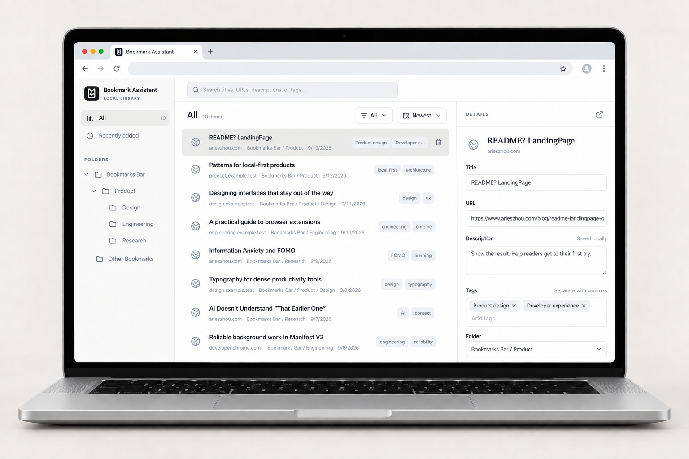

<div align="center">


# Bookmark Assistant

**Manage the Chrome bookmarks you already have.**

Search, edit, tag and organize your library locally. Sync to Notion when you want an
external copy, and add AI summaries and tags with your own provider key.

[Chrome Web Store](https://chromewebstore.google.com/detail/khffaaemphidjmhokafmiilkcjpgiije) ·
[Website](https://bookmarkassistant.com) ·
[Self-hosting](deploy/README.md) ·
[Contributing](CONTRIBUTING.md)

[](LICENSE)




</div>

## Features

- **Local library**: search titles, URLs, descriptions and tags; edit details, move
  bookmarks between folders, find duplicates and remove what you no longer need.
  Chrome bookmarks stay the source of truth, and no account is required.
- **Bookmarks and Reading List to Notion**: connect a workspace through OAuth and
  sync both Chrome sources on demand, with stable link handling to avoid duplicates.
- **Save the current page** without adding it to Chrome bookmarks first.
- **AI summaries and tags** with your own OpenAI, Anthropic, Gemini, DeepSeek, Groq or
  MiniMax key. AI never overwrites your Notion edits. AI currently requires a
  connected Notion destination.

## Plans and deployments

|                                    | Hosted Free | Hosted Pro | Self-hosted |
| ---------------------------------- | :---------: | :--------: | :---------: |
| Local library                      |      ✓      |     ✓      |      ✓      |
| Manual Notion sync and page saving |      ✓      |     ✓      |      ✓      |
| AI for newly saved pages           |      ✓      |     ✓      |      ✓      |
| Scheduled background sync          |             |     ✓      |      ✓      |
| Batch AI for newly synced pages    |             |     ✓      |      ✓      |

The server decides capabilities. Self-hosted deployments include every capability
without an official subscription; hosting and provider costs are the operator's
responsibility. See [self-hosting](deploy/README.md).

## Repository layout

| Package              | Contents                                                          |
| -------------------- | ----------------------------------------------------------------- |
| `packages/extension` | Chrome extension (React, Vite, Manifest V3)                       |
| `packages/server`    | API for OAuth, sync, AI and billing (Express, Prisma, PostgreSQL) |
| `packages/website`   | Product website (Next.js)                                         |
| `packages/types`     | Shared KnowledgeItem, AI and deployment contracts                 |
| `packages/shared`    | Brand artwork and shared scrollbar styles                         |
| `packages/marketing` | Localized public copy and headless rendering tools                |

The root package version is the product version source. Localized copy lives in
`packages/marketing/content` and brand sources in `packages/shared`. Generated mirrors
are build artifacts: run `pnpm resources:sync` and `pnpm resources:check` after
changing their source inputs.

## Development

Use Node 24 and pnpm 9.12.0:

```sh
pnpm install --frozen-lockfile
pnpm -F @bookmark-assistant/types build
pnpm dev            # extension, loads from packages/extension/dist-dev
pnpm dev:server     # API at http://localhost:3333
pnpm dev:website
```

Production builds are the official extension and connect to the official hosted
service by default. The output directory is `packages/extension/dist`:

```sh
pnpm build:prod
pnpm package
```

The extension needs no credentials at build time: users connect Notion with their own
token in Options. Never pass credentials as Vite variables.

## Verification

```sh
pnpm lint
pnpm -F @bookmark-assistant/extension type-check
pnpm test
pnpm build:all
pnpm exec playwright install chromium
pnpm test:e2e:extension
pnpm source:check
```

Routine testing is headless and never opens the system browser.

## Releases and source

Official artwork, store snapshots and hosted-service endpoints are part of this
repository, so a tagged commit is the complete corresponding source of a store
package. Public binary releases must identify their exact source snapshot or commit
and include the applicable third-party notices.

`pnpm source:snapshot` exports the current source, including pending changes, into a
new history-free directory under `.build` with a file checksum manifest. It does not
publish a repository. Review provenance and run the independent secret scan before
publishing.

Older AGPL releases retain their existing grants. Historical repositories and npm
core packages are archival references; current core implementations live here.

## License and trademarks

The extension, server, website, billing implementation and build tools are licensed
under **GPL-3.0-only**; see [LICENSE](LICENSE) and [NOTICE](NOTICE). The Bookmark
Assistant name and logo are covered by [TRADEMARKS.md](TRADEMARKS.md): forks and
independent deployments must use their own name and artwork.

Report vulnerabilities as described in [SECURITY.md](SECURITY.md).
